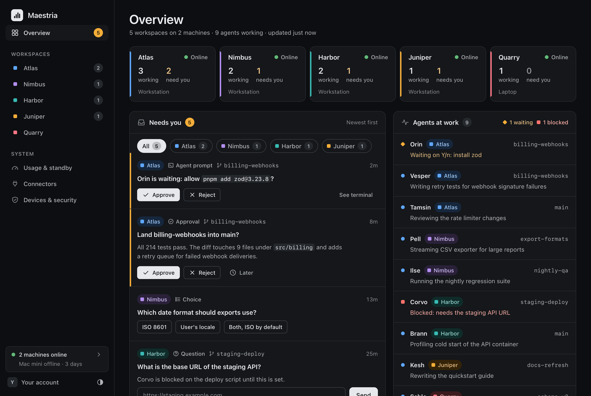
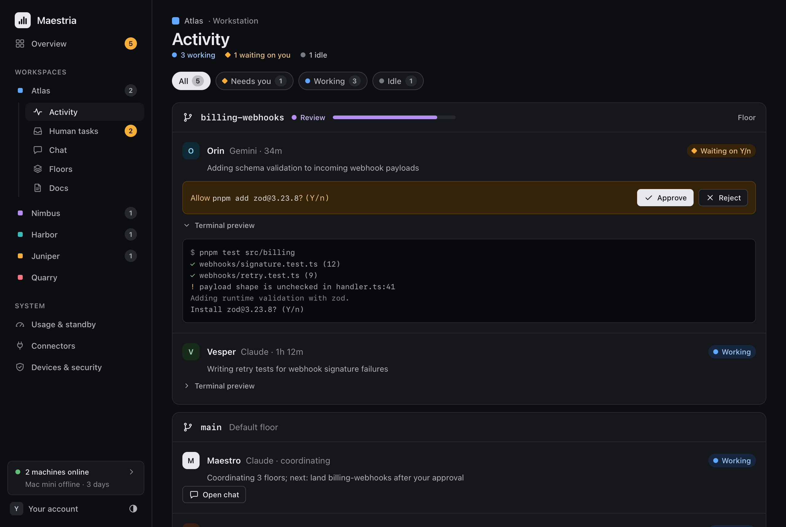
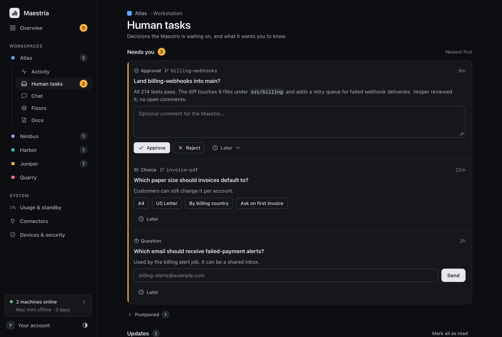
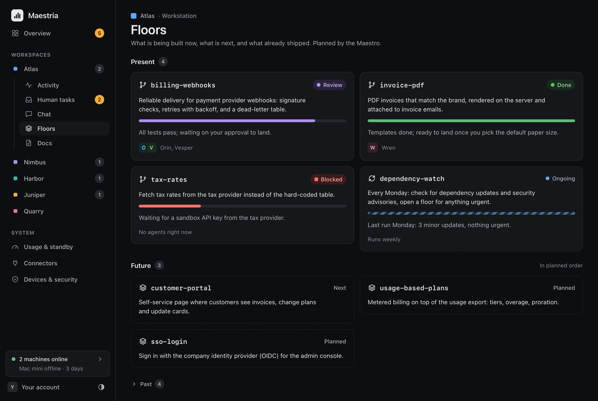

# Maestria

Self-hosted control panel and Maestro protocol add-on for [Maestri](https://github.com/maestria-dev/maestria) workspaces — built in Go as a single binary with an embedded web UI, SQLite state, and optional multi-machine pairing.



## Why Maestria?

When several Maestri agents run across workspaces, floors, and machines, Maestria gives you one place to see what needs you and steer work from a desktop or phone:

- **Overview & Human Tasks (`Needs you`)**: Approve prompts, answer Maestro questions, pick between options, and track updates across workspaces.
- **Live Activity & Chat**: Watch active agents, view live terminal previews, and chat directly with Maestro via Maestri Wire.
- **Floors (Present, Future, Past)**: Inspect worktrees, blockers, and queued floors planned by Maestro.
- **Usage & Standby Guard**: Monitor provider quotas read-only and pause work automatically before hitting session or weekly limits, waking Maestro on reset.
- **Security by Default**: Loopback-only HTTP server (`127.0.0.1:4777`), argon2id password + TOTP 2FA, CSRF protection, strict CSP, audit logging, and a host-enforced kill switch (`maestria tunnel off`) for Cloudflare Tunnel deployments.

| Activity | Human tasks |
| --- | --- |
|  |  |

| Floors | Usage & Standby |
| --- | --- |
|  |  |

---

## Install

### macOS and Linux (`install.sh`)

Installs `maestria` to `~/.local/bin` and verifies its SHA-256 checksum against `SHA256SUMS`:

```sh
curl -fsSL https://raw.githubusercontent.com/maestria-dev/maestria/main/install.sh | sh
```

Optional environment variables:

- `MAESTRIA_VERSION` — pin a release tag (defaults to `latest`)
- `MAESTRIA_INSTALL_DIR` — install destination (defaults to `~/.local/bin`)

### Windows PowerShell (`install.ps1`)

Installs `maestria.exe` to `%LOCALAPPDATA%\Programs\Maestria` (and adds it to your user `Path`), verifying its SHA-256 checksum:

```powershell
irm https://raw.githubusercontent.com/maestria-dev/maestria/main/install.ps1 | iex
```

### Homebrew (macOS and Linux)

Each tagged release generates a `maestria.rb` formula in the GitHub release assets from [packaging/homebrew/maestria.rb](packaging/homebrew/maestria.rb). Install from a tap or directly from the released formula:

```sh
brew install maestria-dev/tap/maestria
```

### From Source (Go 1.27+)

```sh
go install github.com/maestria-dev/maestria/cmd/maestria@latest
```

Verify installation:

```sh
maestria version
```

---

## Quick Start (`maestria init`)

Run the setup wizard in your terminal:

```sh
maestria init
```

`maestria init` is idempotent and walks through:

1. **Maestri data directory & workspace discovery** — checks `MAESTRI_HOME` or `~/.maestri` (read-only on usage data) and lets you pick which workspaces to register.
2. **Authentication setup** — sets your admin password, enrols a TOTP authenticator app, and prints one-time recovery codes (`maestria auth setup`).
3. **Maestri Wire pairing** — optionally pairs with Maestri Wire so Maestria streams live agent status, chat, and floors (`maestria wire pair`).
4. **Standby guard defaults** — optionally configures pause thresholds for provider usage.
5. **Maestro skill install** — installs the embedded `maestria-maestro` skill into Claude (`~/.claude/skills`) and/or Antigravity (`~/.gemini/config/skills`).
6. **Background service** — optionally installs (and starts) the OS user service.

### Non-Interactive Setup

For scripts or headless machines:

```sh
maestria init \
  --maestri-dir ~/.maestri \
  --workspaces all \
  --standby default \
  --skill both \
  --service install \
  --skip-auth \
  --skip-wire \
  --yes
```

Run `maestria init --help` for all flags. Config and SQLite state live in `$MAESTRIA_CONFIG_DIR`, `%AppData%\maestria` (Windows), or `~/.config/maestria` (with `0600` secret permissions).

---

## Background Service (`maestria service`)

Manage Maestria as an OS user service across macOS (`launchd`), Linux (`systemd --user`), and Windows (Task Scheduler):

```sh
maestria service install [--mode serve|connect]
maestria service status
maestria service start
maestria service stop
maestria service restart
maestria service logs [-n 100]
maestria service uninstall
```

- `--mode serve` (default) runs `maestria serve` for local/tunnel hosting.
- `--mode connect` runs a connector process for multi-machine setups.
- Logs are stored in `<configDir>/logs/`.

---

## Local Mode, Cloudflare Tunnel & Kill Switch

By default, `maestria serve` listens exclusively on **`127.0.0.1:4777`** and refuses to expose an unencrypted LAN or public port.

To reach your panel securely from a phone or away from your desk:

1. Point a **Cloudflare Tunnel** (`cloudflared`) at `http://127.0.0.1:4777`.
2. Optionally put **Cloudflare Access** in front of that hostname and configure `cloudflareAccess` (`teamDomain` and `audience`) in `config.json` so Maestria verifies the `Cf-Access-Jwt-Assertion` header on every request.
3. Use the **kill switch** whenever you want to cut off external access immediately:
   - From the panel UI or CLI (`maestria tunnel off`), non-loopback requests are blocked with `503`.
   - Re-enabling tunnel access (`maestria tunnel on`) is **only allowed locally** over CLI or `127.0.0.1` — never from a remote session.
   - Check state anytime with `maestria tunnel status`.

---

## Maestri Wire Pairing

Connect Maestria to a running Maestri instance on the same machine or over Maestri Wire for live agent activity, chat, and floor state:

```sh
maestria wire pair
maestria wire status
maestria wire unpair
```

During setup, `maestria init` also offers to pair right away.

---

## Maestro Protocol & Agent Integration

Agents and Maestros communicate with the panel through the `maestria` CLI (`post`, `inbox`, `answers`, `say`, `wait`, `status`, `floor`, `agent brief`) backed by a clear text/JSON protocol:

- Protocol specification: [docs/protocol.md](docs/protocol.md)
- Installed agent skill: [skills/maestria-maestro/SKILL.md](skills/maestria-maestro/SKILL.md) (embedded directly into the Go binary so `maestria init` always installs the matching skill)

---

## Hosted Mode (`maestria-cloud` + `maestria connect`)

One web panel for every machine, with no tunnel and no open port on your machines. `maestria-cloud` is a multi-tenant server (accounts, mandatory 2FA, a relay); each machine runs `maestria connect`, which dials out to it. The cloud stores accounts and linked machines only: **no workspace data**, and relayed bodies are never logged or kept. Every command is signed by a browser you approved **on the machine itself**, and the machine checks the signature, so the cloud can relay but cannot forge anything. Full contract and threat model: [docs/hosted-protocol.md](docs/hosted-protocol.md).

Run the server (behind a reverse proxy or tunnel that terminates TLS):

```bash
export MAESTRIA_CLOUD_PUBLIC_URL=https://maestria.example
export MAESTRIA_CLOUD_SMTP_HOST=smtp.example.com MAESTRIA_CLOUD_SMTP_FROM=maestria@example.com
maestria-cloud serve                 # 127.0.0.1:8080 by default (MAESTRIA_CLOUD_LISTEN)
# local trial without a mail server: MAESTRIA_CLOUD_DEV_EMAIL=stdout
maestria-cloud user list|disable|enable EMAIL
```

Sign up in the browser (email, password, authenticator app), then on each machine:

```bash
maestria connect --link XXXX-XXXX --cloud https://maestria.example   # code shown in the web
maestria connect --cloud https://maestria.example                    # or: the CLI shows a code, you type it in the web
maestria devices pending && maestria devices approve <code>          # approve each browser, here, once
maestria connect status | maestria connect unlink
```

Per-machine policy (device approval and idle limits, rate limit) lives in the `relay` section of the machine's `config.json`; the local kill switch (`maestria tunnel off`) blocks the relay entirely. Local mode (`maestria serve`) is unchanged.

---

## Security Model

Maestria is designed for single-owner remote control of local developer machines:

- **Loopback bind only**: `127.0.0.1` is fixed; TLS/edge termination belongs to Cloudflare Tunnel or localhost.
- **No CORS, strict CSP**: cross-origin requests are rejected and inline script execution is locked down.
- **CSRF on every write**: state-changing HTTP endpoints enforce CSRF verification.
- **Strong authentication**: passwords hashed with **argon2id**, mandatory **TOTP 2FA** setup with recovery codes, rate-limited logins with IP + global lockouts, and `maestria auth reset-sessions`.
- **Cloudflare Access JWT verification**: optional second layer checked server-side when configured.
- **Local-only kill switch recovery**: `maestria tunnel off` locks down non-loopback access and cannot be undone remotely.
- **Audit log**: every write action is recorded in SQLite.
- **Read-only provider usage**: `<maestriDir>/usage/providers/` is never modified by Maestria.

For architecture and design details, see [docs/v2-spec.md](docs/v2-spec.md) and [docs/v2-architecture.md](docs/v2-architecture.md).

---

## Development (Go)

Requirements: Go 1.27+.

```sh
go vet ./...
go test -count=1 ./...
go run ./tools/syncdesign -check
go mod tidy -diff
```

Build release archives locally for `darwin/arm64`, `darwin/amd64`, `linux/amd64`, `linux/arm64`, and `windows/amd64` with `-trimpath`, version ldflags, `SHA256SUMS`, and the filled Homebrew formula:

```sh
go run ./tools/release \
  -out dist/release \
  -version v0.2.0 \
  -homebrew-template packaging/homebrew/maestria.rb \
  -homebrew-out dist/release/maestria.rb
```

---

## Legacy (V1)

An unreleased Node.js/TypeScript prototype still lives under `src/`, `public/`, and `test/` and will be removed. It is not distributed and there is no migration path from it.

V1 development commands:

```sh
pnpm build
pnpm typecheck
pnpm test
```

---

## License

[MIT](LICENSE)
