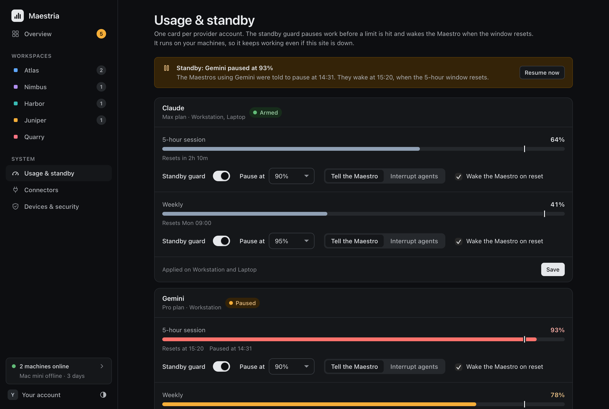
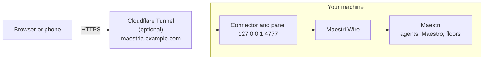
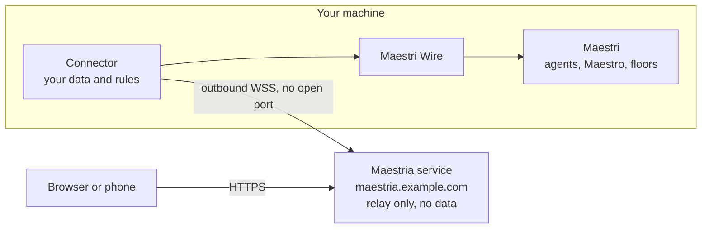

# Maestria

**A control panel for [Maestri](https://www.themaestri.app).** See what your AI agents are doing, answer their questions, and follow your floors and your usage, from your computer or your phone.

When agents work for hours on several projects, they stop and ask: *"Can I merge this?"*, *"Which database?"*. Maestria collects those questions in one place, so you can answer in seconds and let the work go on. It is open source (MIT), and your data stays on your machine.


| Needs you | Activity | Floors | Usage and standby |
| --- | --- | --- | --- |
|  |  |  |  |

## What you get

- **Needs you:** approve, reject, answer or choose, from anywhere.
- **Live activity and chat:** which agent does what, and a chat with your Maestro (through Maestri Wire).
- **Floors:** what is planned, what is in progress, what landed.
- **Usage and standby:** your AI limits, and an automatic pause before you hit them.
- **A kill switch** that cuts off remote access in one click.

## Choose your setup

There are two ways to run it. Both give you the same panel.

| | **Self-host** | **Hosted** |
| --- | --- | --- |
| It runs | On your own machine | On a Maestria server, with accounts |
| Your machine | Serves the panel on `127.0.0.1` | Connects *out* to the server |
| From your phone | Through a free Cloudflare Tunnel | Sign in, nothing else to set up |
| Several machines | One panel each | One panel for all |
| Guide | [Self-host](docs/self-host.md) | [Use a hosted Maestria](docs/hosted.md) |

**Self-hosted:** the panel lives on your machine. A tunnel is optional.



**Hosted:** the server only relays. Your machine holds the data and decides what is allowed.



Not sure which one? Start with self-host. Words you do not know are explained in [Concepts](docs/concepts.md).

## Quick start

**1. Install** (macOS and Linux):

```sh
curl -fsSL https://raw.githubusercontent.com/paulo-lucas/maestria/main/install.sh | sh
```

On Windows (PowerShell):

```powershell
irm https://raw.githubusercontent.com/paulo-lucas/maestria/main/install.ps1 | iex
```

With Homebrew: `brew install paulo-lucas/tap/maestria`. Other ways and more detail: [Getting started](docs/getting-started.md#1-install-maestria).

**2. Set up** (open a new terminal first):

```sh
maestria init
```

The wizard asks a few questions and explains each one. Press Enter to accept the suggestion. It sets your password and authenticator app, and can start Maestria in the background.

**3. Open the panel** at <http://127.0.0.1:4777>.

Using a hosted server? Link your machine instead, with the code the server shows you:

```sh
maestria connect --link XXXX-XXXX --cloud https://maestria.example.com
```

New to the terminal? [Getting started](docs/getting-started.md) walks through every step and shows what you should see.

## Guides

| Guide | For |
| --- | --- |
| [Getting started](docs/getting-started.md) | Everyone. Install and first run, step by step. |
| [Concepts](docs/concepts.md) | Everyone. What the words mean, with diagrams. |
| [Self-host](docs/self-host.md) | Run it on your machine, reach it from your phone, update, back up. |
| [Use a hosted Maestria](docs/hosted.md) | Sign in to a server, link machines, approve browsers. |
| [Run your own hosted server](docs/deploy-cloud.md) | Operators. A free VM, a systemd unit, a Cloudflare Tunnel. |
| [Connect to Maestri Wire](docs/wire.md) | Live agents and chat. |
| [For Maestro agents](docs/for-agents.md) | The `maestria` command line for agents and scripts. |
| [Security](docs/security.md) | How it protects you, in plain words and in detail. |
| [FAQ](docs/faq.md) and [Troubleshooting](docs/troubleshooting.md) | Questions, and what to do about an error message. |

All guides are listed in [docs/README.md](docs/README.md).

## Security in three lines

- **Nothing listens to the internet.** The panel binds `127.0.0.1` only, and the hosted setup connects out. No port is opened.
- **Two locks to sign in:** a password (argon2id) and an authenticator code, with limits on failed attempts. In hosted mode, each browser is also approved once on your machine, and every request is signed.
- **You can pull the plug.** The kill switch cuts off remote access, and only someone at your machine can turn it back on. Every change is in an audit log.

Read more in [Security](docs/security.md).

## Development

Go 1.27 or newer.

```sh
go vet ./...
go test ./...
go mod tidy -diff
go build -o maestria ./cmd/maestria
go build -o maestria-cloud ./cmd/maestria-cloud
```

After changing the panel's design in `design/`, run `go generate ./internal/ui`. Release archives for all five targets, with checksums and the Homebrew formula, come from `go run ./tools/release`.

More: the design of the panel is in [design/](design/README.md), the product decisions in [docs/v2-spec.md](docs/v2-spec.md), the architecture in [docs/v2-architecture.md](docs/v2-architecture.md), the Maestro protocol in [docs/protocol.md](docs/protocol.md) and the hosted protocol in [docs/hosted-protocol.md](docs/hosted-protocol.md).

## License

[MIT](LICENSE)
