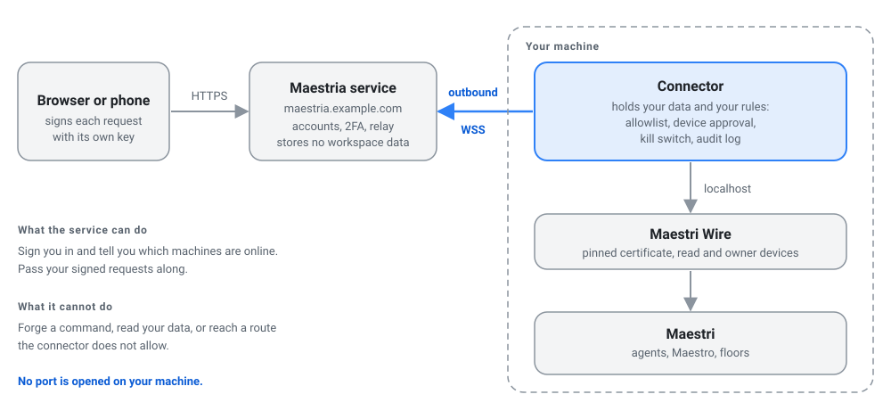
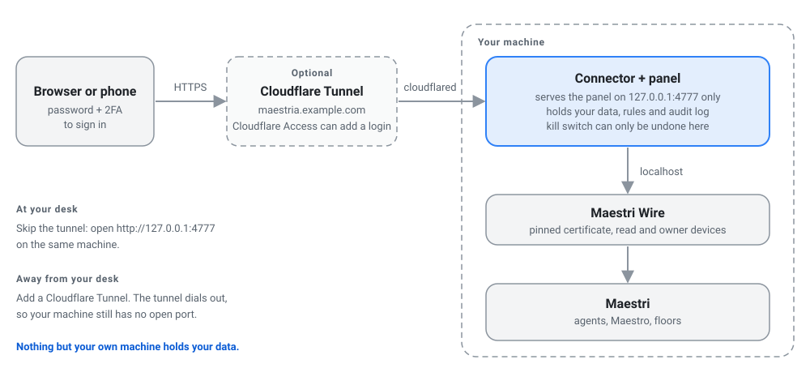

# Maestria documentation

Pick the guide that matches what you want to do. If you are new, read the first two in order.

## Start here

| Guide | Who it is for | You will learn |
| --- | --- | --- |
| [Getting started](getting-started.md) | Everyone, even if you rarely use a terminal | Install Maestria, run the setup wizard, open the panel, sign in, and find your way around. |
| [Concepts](concepts.md) | Everyone | What Maestri, the Maestro, floors, Wire, the connector and the hosted server are, with diagrams of both setups. |

## Set it up

| Guide | Who it is for | You will learn |
| --- | --- | --- |
| [Self-host](self-host.md) | People who run Maestria on their own machine | Run it as a service, reach it from your phone with a Cloudflare Tunnel, add Cloudflare Access, use the kill switch, update, back up, uninstall. |
| [Use a hosted Maestria](hosted.md) | People whose server is run by someone else (or by themselves) | Create an account, link a machine, approve your browser, what leaves your machine, revoke devices, use several machines. |
| [Run your own hosted server](deploy-cloud.md) | Operators: you, a friend or a team | A free VM, `maestria-cloud`, all settings, email, a ready-to-copy systemd unit, a Cloudflare Tunnel, first steps, updates and backups. |
| [Connect to Maestri Wire](wire.md) | Anyone who wants live agents and chat | Turn Wire on, pair with `maestria wire pair`, what Maestria can and cannot do, unpair. |

## Use it

| Guide | Who it is for | You will learn |
| --- | --- | --- |
| [For Maestro agents](for-agents.md) | Agents, and people who script | The `maestria` command line: post, inbox, answers, say, wait, status, floors, briefs, standby. |
| [Security](security.md) | Everyone who wants to know how it is protected | The model in plain words, then local mode, hosted mode and the threat model. |
| [FAQ](faq.md) | Everyone | Short answers to common questions. |
| [Troubleshooting](troubleshooting.md) | Anyone who sees an error | Real error messages and how to fix each one. |

## Reference

For contributors and the curious.

| Document | What it is |
| --- | --- |
| [protocol.md](protocol.md) | The Maestro-side CLI protocol: commands, events, floors. |
| [hosted-protocol.md](hosted-protocol.md) | The hosted relay protocol, device pairing and the full threat model. |
| [maestri-wire.md](maestri-wire.md) | Notes on Maestri Wire and how Maestria uses it. |
| [v2-spec.md](v2-spec.md) | The product decisions. |
| [v2-architecture.md](v2-architecture.md) | How it is built. |
| [releasing.md](releasing.md) | Cutting a release or prerelease, how machines update, rolling back. |
| [../design/README.md](../design/README.md) | The panel's design system and screens. |

## Screenshots

Screenshots of the panel are in [images/](images/). They show sample data. Each one exists at desktop width (1280) and the main pages also at phone width (390, files starting with `mobile-`). Two architecture diagrams, which work in light and dark mode, are [architecture-hosted.svg](images/architecture-hosted.svg) and [architecture-self-hosted.svg](images/architecture-self-hosted.svg).

  
  

