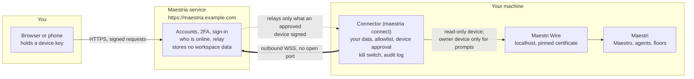
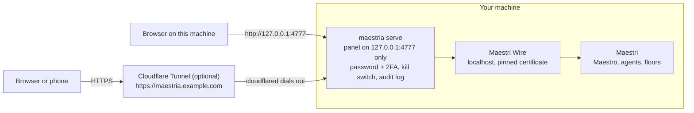

# Concepts

New to all of this? Read this page once. It explains every word the other guides use, in plain language.

## The short version

- **Maestri** is an app where AI agents work on your projects.
- **Maestria** is a control panel for Maestri. You open it in a browser, on your computer or your phone.
- In the panel you see what your agents are doing and you answer when they need you.

## The words

### Maestri
A desktop app (macOS and Windows) that runs AI coding agents, such as Claude Code, side by side on a canvas. Maestria does not replace it. It sits next to it.

### Workspace
One project in Maestri. It has its own canvas and its own folder on your disk.

### Floor
A level inside a workspace. A floor is often a separate copy of your code (a git worktree) on its own branch, so work on one floor cannot break another. When the work is done, the floor is *landed*: its branch is merged back.

### Agent
An AI assistant running in a terminal inside Maestri. It writes code, runs tests, and so on.

### Maestro
The agent in charge of a workspace. It hands work to the other agents. **The Maestro is the one that talks to you through Maestria.** When it needs a decision, it posts a task for you.

### Maestri Wire
A feature of Maestri that lets other programs read what is happening (agents, chat, floors) and, with permission, send a message. It is off by default. You turn it on in Maestri: **Settings → Wire**. Maestria uses it to show live agents and chat. See [Connect Maestria to Maestri Wire](wire.md).

### Maestria
The project in this repository. It is one program, `maestria`, plus an optional server, `maestria-cloud`.

### The panel
The web page Maestria shows you. It has an **Overview**, and for each workspace: **Activity**, **Human tasks**, **Chat**, **Floors** and **Docs**. It also has **Usage & standby** and **Security**.

### The connector
The part of Maestria that runs **on your machine**. It reads Maestri, keeps your data in a small local database, and decides what is allowed. Whatever happens, the connector has the last word. In the hosted setup it is started with `maestria connect`. In the self-hosted setup it is the same program, started with `maestria serve`.

### The hosted server
A Maestria server (`maestria-cloud`) that someone runs for you, or that you run yourself. It has accounts and a sign-in page, and it **relays** your browser to your connector. It stores **no** workspace data. See [Use a hosted Maestria](hosted.md) and [Run your own hosted server](deploy-cloud.md).

### Human tasks
Things an agent needs *you* for. There are four kinds:

| Kind | What you see | Example |
| --- | --- | --- |
| **Notice** | Text and a "Got it" button | "Deployed staging." |
| **Approval** | Approve / Reject, plus an optional comment | "Merge PR #42 into main?" |
| **Question** | A text box | "Which domain should we use?" |
| **Choice** | 2 to 4 buttons | "PostgreSQL or SQLite?" |

Tasks that need you are listed under **Needs you**. You can also postpone one with **Later**. Answered tasks move to **History**. If an agent in Maestri is waiting for a yes/no, it shows up there too, as an **Agent prompt**.

### Standby
A safety brake for your AI usage. Each AI provider has limits (for example a session limit and a weekly limit). Maestria watches them. When you get close to a limit that you set, it puts the workspace on **standby**: either it tells the Maestro, or it interrupts the agents. When the limit resets, it wakes the Maestro up again. Maestria only *reads* Maestri's usage files. It never changes them.

### The kill switch
One button (and one command, `maestria tunnel off`) that cuts off every remote way in. It can be turned on from anywhere. It can only be turned off **on the machine itself**. See [Security](security.md).

## How the pieces connect

You choose one of two setups. They use the same panel.

### Setup A: hosted

You sign in to a Maestria server. Your machine dials **out** to it. Nothing on your machine listens to the internet.

What to take from it:

- The **connector holds your data** and **makes the security decisions**.
- The **service only relays**. It cannot forge a command, because every request is signed by a browser you approved on your own machine.
- **No port is open** on your machine. The connector connects out.

Prefer a picture? Here it is as an image: [architecture-hosted.svg](images/architecture-hosted.svg).

### Setup B: self-hosted

You run the panel on your own machine. At your desk you open it directly. Away from your desk, you can put a **Cloudflare Tunnel** in front of it.

What to take from it:

- The panel listens on `127.0.0.1` only. That address is reachable from your own machine and nowhere else. This cannot be changed.
- The tunnel is **optional**, and it dials out too.
- Everything stays on your machine.

Image version: [architecture-self-hosted.svg](images/architecture-self-hosted.svg).

### Both at once

You can do both. After `maestria connect`, the command `maestria serve` also keeps the hosted connection. One program, one panel on your machine, one panel in the hosted server.

## Which setup should I pick?

| | Self-host | Hosted |
| --- | --- | --- |
| You need | Only your machine | An account on a Maestria server |
| Phone access | Needs a Cloudflare Tunnel (free) | Works as soon as you sign in |
| Several machines | One panel per machine | One panel for all of them |
| Who runs the server | You, on your machine | You, a friend or your team |
| Start here | [Getting started](getting-started.md), then [Self-host](self-host.md) | [Use a hosted Maestria](hosted.md) |

Not sure? Start with **self-host**. You can add hosted mode later.

## Next

- [Getting started](getting-started.md): install and set up, step by step.
- [Security](security.md): what protects you and how.
