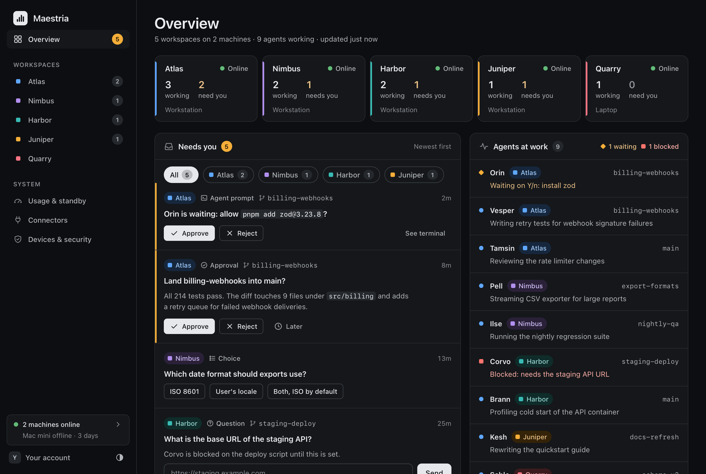
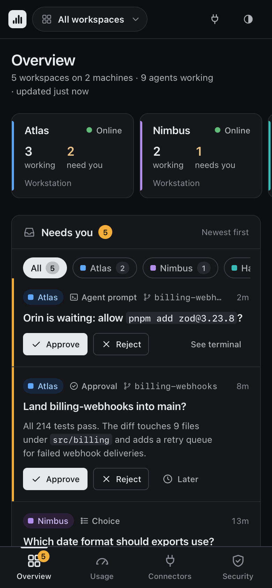

# Getting started

This guide takes you from nothing to a working panel on your own machine. It is written for people who do not use the terminal much. Every step says what to type and what you should see.

**Time needed:** about 10 minutes.

**You need:**

- Maestri installed on this computer, with at least one workspace.
- A phone or an authenticator app for two-factor login (Google Authenticator, 1Password, Authy, Aegis, or similar).

Words you do not know? See [Concepts](concepts.md).

> **Using a hosted Maestria server instead?** Skip to [Use a hosted Maestria](hosted.md). You still need to install Maestria (step 1 below).

## What a terminal is

The **terminal** is a window where you type commands.

- **macOS:** open **Terminal** (press `⌘ Space`, type "Terminal", press Enter).
- **Windows:** open **PowerShell** (press the Windows key, type "PowerShell", press Enter).
- **Linux:** open your terminal app.

A command goes in a grey box like the ones below. Type it (or paste it), then press **Enter**.

## 1. Install Maestria

Pick **one** way.

### macOS or Linux: the install script

```sh
curl --proto '=https' --tlsv1.2 -fsSL https://raw.githubusercontent.com/paulo-lucas/maestria/main/install.sh | sh
```

The script downloads the right program for your computer, checks its checksum (a fingerprint that proves the file is intact), and puts it in `~/.local/bin`.

If [cosign](https://docs.sigstore.dev/cosign/system_config/installation/) is installed, the script also checks the release's signature, which proves it was built by this project's release process and not just that the file is intact. Without cosign it says so and carries on with the checksum alone. More in [Verify a download](security.md#verify-a-download).

### macOS or Linux: Homebrew

If you already use [Homebrew](https://brew.sh):

```sh
brew install paulo-lucas/tap/maestria
```

### Windows: PowerShell

```powershell
[Net.ServicePointManager]::SecurityProtocol = [Net.ServicePointManager]::SecurityProtocol -bor 3072; irm https://raw.githubusercontent.com/paulo-lucas/maestria/main/install.ps1 | iex
```

This installs `maestria.exe` to `%LOCALAPPDATA%\Programs\Maestria` and adds it to your `Path`.

### Check it worked

**Close your terminal and open a new one** (this lets it find the new program). Then:

```sh
maestria version
```

**What you should see:** a line with the program name and its version number, like `maestria 0.2.0`.

**If you see "command not found":** the install folder is not on your `PATH`. On macOS and Linux, add this line to your `~/.zshrc` or `~/.bashrc`, then open a new terminal:

```sh
export PATH="$HOME/.local/bin:$PATH"
```

## 2. Turn on what Maestri needs to share

Maestria reads your usage from Maestri. In Maestri, open **Settings → Agents → Usage** and make sure usage is on. It is fine if you skip this: Maestria just shows no usage until you turn it on.

Maestri Wire (live agents and chat) comes later in this guide. You do not need it yet.

## 3. Run the setup wizard

```sh
maestria init
```

The wizard asks a few questions. **Press Enter to accept the answer in brackets**, such as `[1]` or `[y/N]`. You can run it again at any time. It keeps what you already set up and asks before changing anything.

It starts with:

```text
Using config directory: /Users/you/.config/maestria
```

This is where Maestria keeps its settings and data. It is never inside a project folder. (On Windows it is `%AppData%\maestria`.)

Here is every question, in order.

### Question 1: Maestri data directory

```text
Maestri data directory:
  1) Use default (/Users/you/.maestri) (default)
  2) Enter a custom path
Choice [1]:
```

This is the folder where Maestri keeps its data, including the usage files Maestria reads. **Press Enter.** Choose 2 only if you moved Maestri's data somewhere else.

**What you should see:** `Verified Maestri usage providers at …`. If you see `Note: … waiting for Maestri to write .status.json`, usage is not on yet (step 2). That is fine.

Maestria only **reads** this folder. It never changes it.

### Question 2: Workspaces

```text
Detected 2 new Maestri workspace(s):
  1) Atlas (/Users/you/code/atlas)
  2) Nimbus (/Users/you/code/nimbus)
Select workspaces to add (numbers like 1,2, 'all', or 'none') [all]:
```

These are the Maestri workspaces Maestria found. **Press Enter** to add all of them, or type `1` to add only the first. Add more later with `maestria workspace add`.

### Question 3: Standby

```text
Usage standby thresholds (auto-pause agents near quota limits):
  1) Use defaults (claude: session 95%, weekly 90%; resume on reset or below 80%) (default)
  2) Customize provider/window thresholds
  3) Disable automatic standby
Choice [1]:
```

Standby pauses your agents before you hit an AI usage limit. **Press Enter** for the defaults: pause at 95% of the session limit or 90% of the weekly limit, and carry on when the limit resets or usage drops below 80%.

### Question 4: Password and authenticator app

```text
New password (at least 12 characters):
Repeat password:
```

Choose a long password. **Nothing appears as you type.** That is normal. A password manager is a good idea.

Next, a square barcode (a **QR code**) appears in the terminal:

```text
Scan this QR code with your authenticator app:
…
Or enter the key manually: ABCD EFGH IJKL MNOP
```

1. Open your authenticator app on your phone.
2. Add a new account and scan the QR code. If scanning does not work, type the key by hand.
3. The app now shows a 6-digit code that changes every 30 seconds.

```text
Enter the 6-digit code shown by the app to confirm:
```

Type the current 6-digit code and press Enter.

Last, you get your **recovery codes**:

```text
Recovery codes (each works once; they are shown only now, keep them in a password manager):

  xxxx-xxxx
  …
```

**Save these now.** Copy them into a password manager or print them. If you lose your phone, a recovery code is the only way back in. Each one works once, and they are never shown again.

### Question 5: Public address

```text
Public address (local mode only). Allowed hosts today: none.
Host name (e.g. panel.example.com):
```

If you will open the panel through your own domain (for example with a Cloudflare Tunnel, see [Self-host](self-host.md)), type that name now. **If you just want to use the panel on this computer, press Enter to skip.** You can add it later with `maestria config allow-host`.

### Question 6: Maestri Wire

```text
Pair with Maestri Wire now (live agents, chat, floors)? [y/N]:
```

Wire lets the panel show live agents and chat. **You can answer `n` now** and do it later with [the Wire guide](wire.md). Without Wire the panel still shows the tasks your Maestro posts, usage and standby.

### Question 7: The Maestro skill

```text
Install Maestro protocol skill for:
  1) Both Claude Code and Antigravity (…) (default)
  2) Claude Code only (…)
  3) Antigravity only (…)
  4) Skip skill installation
Choice [1]:
```

A **skill** is a short instruction file that teaches an AI agent how to use a tool. This one teaches your Maestro how to talk to you through Maestria: post tasks, answer in chat, and pause on standby. Choose the agents you use. If you are not sure, press Enter.

### Question 8: Background service

```text
Keep Maestria running in the background?
  1) Install and start background service now (recommended)
  2) Install service now, start later
  3) Skip for now (start manually with "maestria serve")
Choice [1]:
```

A **service** is a program your computer starts for you, so the panel is always there. **Choose 1.** It uses launchd on macOS, `systemd --user` on Linux, and Task Scheduler on Windows. No administrator rights are needed.

### The end

```text
Setup complete.
  Panel:   http://127.0.0.1:4777 (this machine only)
```

If you chose to skip the service, start the panel yourself and leave that terminal window open:

```sh
maestria serve
```

**What you should see:** `maestria listening on http://127.0.0.1:4777`.

> **Script it:** every question has a flag, so `maestria init` also runs without a keyboard. See `maestria init --help`, and [Self-host](self-host.md).

## 4. Open the panel

Open your web browser and go to:

```text
http://127.0.0.1:4777
```

**What you should see:** a sign-in page.

**If the page does not load:** run `maestria status`. If it says `Server: down`, run `maestria service start` (or `maestria serve`).

**Safari on plain `http`:** Safari does not accept the panel's secure cookie over plain `http://`. If you cannot sign in, use Chrome or Firefox for this address, or set `"cookieSecure": false` in `~/.config/maestria/config.json` and restart (`maestria service restart`). When you reach the panel through a Cloudflare Tunnel (https), leave it on.

## 5. Sign in for the first time

1. Type your **password** and continue.
2. Type the **6-digit code** from your authenticator app. (Lost your phone? Use a recovery code instead.)

**What you should see:** the **Overview** page. It will look empty until your Maestro posts something. That is normal.

Signing in always asks for both. Maestria never sends a hint about which one was wrong.

## 6. What each page shows

You can see all of these pages in the [screenshots](images/).

| Page | What it is for |
| --- | --- |
| **Overview** | Every workspace at a glance: how many agents work, and everything that **Needs you**. Start here. |
| **Activity** | One workspace. Each agent, which floor it is on, what it is doing, and a live terminal preview. Needs Wire. |
| **Human tasks** | One workspace. The questions, approvals and choices waiting for you, plus Updates and History. |
| **Chat** | One workspace. Talk to the Maestro. Needs Wire to send messages. |
| **Floors** | One workspace. **Present** (active) floors with progress, **Future** (planned) floors, and **Past** (landed or cancelled) floors. |
| **Docs** | One workspace. The project's `docs/` folder, read-only. |
| **Usage & standby** | Your AI usage per provider and window, and the standby settings. |
| **Security** | Sessions, the **kill switch**, and the audit log (a list of everything that was changed). |

On a phone, the pages you need most are at the bottom of the screen.

<p>
  
  
</p>

## 7. Try it

The panel shows what your Maestro posts. Make it say something. Open a terminal **inside a project folder that you added in step 3** and run:

```sh
maestria post --kind notice "Hello from the terminal"
```

**What you should see:** `Posted notice #1 to …`. Refresh the panel. The notice shows up under the workspace's **Human tasks**.

Try a question too:

```sh
maestria post --kind approve "Is this working?"
```

You can now **Approve** or **Reject** it in the panel. Read the answer back with:

```sh
maestria answers
```

Your real Maestro does this by itself, because step 3 installed the skill. Ask it something like "Use Maestria to tell me when you finish this".

## What next?

- **Use it from your phone:** [Self-host](self-host.md) (Cloudflare Tunnel), or [Hosted](hosted.md).
- **See live agents and chat:** [Connect to Maestri Wire](wire.md).
- **Something wrong?** [Troubleshooting](troubleshooting.md).
