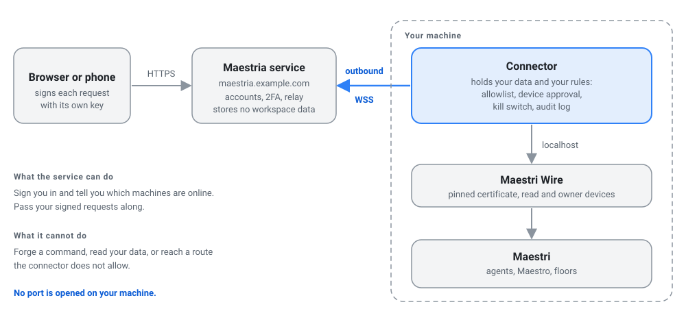
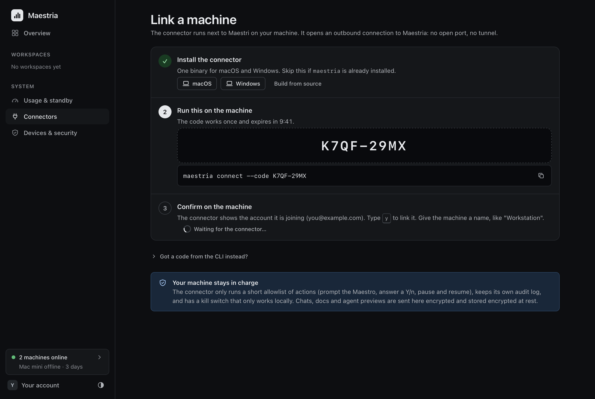
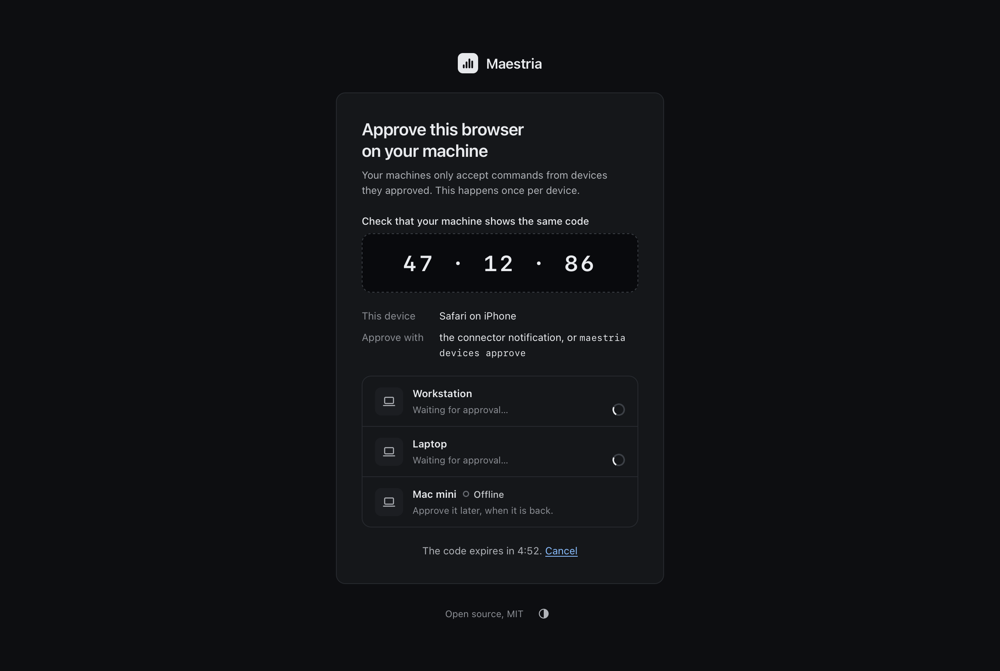
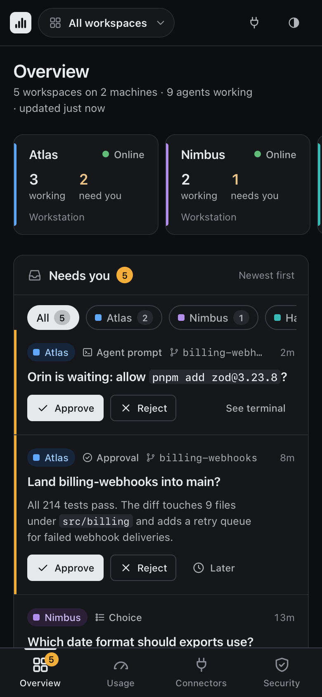
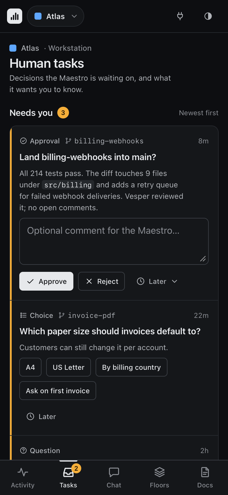

# Use a hosted Maestria

A **hosted Maestria** is a Maestria server that lives on the internet. You sign in with an account and see all your machines in one place, **without a tunnel and without opening any port** on your computers.

This guide is for **users** of a hosted server. Someone (you, a friend, your team) already runs it, and you have its address, for example `https://maestria.example.com`. If you want to run one, see [Run your own hosted server](deploy-cloud.md).



## How it fits together, in four lines

1. Your machine runs the **connector** (`maestria connect`). It dials **out** to the server.
2. You sign in to the server in a browser, with a password and a 6-digit code.
3. You **approve each browser on each machine**, once. That is what makes it safe.
4. The server only passes your requests along. Your machine checks each one.

New words? See [Concepts](concepts.md).

## Before you start

- [Install Maestria](getting-started.md#1-install-maestria) on the machine that runs Maestri.
- Run `maestria init` there (see [Getting started](getting-started.md)). You can skip the public address, the password and the background service questions if you only use hosted mode. You may still want [Wire](wire.md) for live agents and chat.
- Know your server's address (`https://maestria.example.com` below).

## 1. Create your account

1. Open `https://maestria.example.com` and choose **Create an account**.
2. Enter your **email** and a **password** (at least 12 characters).
3. **What you should see:** a "Check your email" page. It looks the same whether or not the address is already registered, on purpose.
4. Open the email and click the link. A page asks you to type your password once more to confirm. Do that.
5. **Set up two-factor sign-in.** The page shows a QR code. Scan it with an authenticator app (Google Authenticator, 1Password, Authy, Aegis...) and type the 6-digit code it shows.
6. **Save your 10 recovery codes.** They are shown **once**. Copy them to a password manager. Each works one time, and they are your way back in if you lose your phone.

**An account without two-factor sign-in cannot sign in at all.** This is not optional.

**Didn't get the email?** Check spam. The link lasts 30 minutes. Choose **Resend email** on the "Check your email" page. If you opened the link on another device, choose **Continue here** on that page. If the server's owner did not set up email, ask them. See [Troubleshooting](troubleshooting.md).

**Forgot your password?** Choose **Forgot password?** on the log-in page. You need a code from your authenticator app (or a recovery code) as well as the email link, and a reset never turns two-factor off. After a reset, every browser must be approved again on each machine.

## 2. Link your machine

Linking connects **one machine** to **your account**. There are two ways. Pick whichever is easier.

### Way A: the web shows a code

1. In the web app, open **Connectors**, then **Link a machine**.
2. The page shows a code like `ABCD-2345` and the command to run.
3. On your machine, in a terminal:

   ```sh
   maestria connect --link ABCD-2345 --cloud https://maestria.example.com
   ```

4. **What you should see:**

   ```text
   This machine would join the account y***@example.com.
   Name for this machine [my-laptop]:
   Link this machine to y***@example.com as "my-laptop"? [y/N]
   ```

   Check that the account looks like yours, give the machine a name (or press Enter), and type `y`.
5. **What you should see next:**

   ```text
   Linked as "my-laptop". The credential is stored in … (owner-only).
   Connecting to https://maestria.example.com. Approve browsers on this machine with "maestria devices".
   ```

   The web page changes from "Waiting for the connector…" to "Linked".



### Way B: the terminal shows a code

1. On your machine:

   ```sh
   maestria connect --cloud https://maestria.example.com
   ```

2. It prints a code and an address:

   ```text
   Open https://maestria.example.com/… and enter this code (valid 10 minutes):

       ABCD-2345

   Waiting for you to enter it…
   ```

3. Enter the code in the web app, on **Connectors → Link a machine**.
4. Back in the terminal, confirm the account and the machine name with `y`.

**Both ways ask you to confirm on the machine.** That means a leaked code alone cannot link a machine: someone must be at that terminal. A code lasts **10 minutes** and works **once**.

### Keep it running

`maestria connect` must stay running. The easiest way is a background service:

```sh
maestria service install --mode connect
maestria service start
```

If you also want the local panel on this machine, use `--mode both` instead. It runs `maestria serve --connect`: the local panel and the hosted connection in one process. (Once a machine is linked, plain `maestria serve` also connects, unless you pass `--no-connect`.)

Check the link:

```sh
maestria connect status
```

**What you should see:**

```text
Linked to:        https://maestria.example.com
Machine:          my-laptop (cn_…)
Connection:       online
Approved devices: 0
Waiting to pair:  0
Kill switch:      off
```

## 3. Approve your browser on the machine

This is the most important step, and the one that makes hosted mode safe. **Every browser or phone must be approved on each machine**, once. The server cannot do it for you.

1. Open the web app in your browser. You see **Approve this browser on your machine**.
2. It shows one **code per online machine**, like `47 · 12 · 86`.
3. On that machine, in a terminal:

   ```sh
   maestria devices pending
   ```

   **What you should see:**

   ```text
   47 · 12 · 86  Safari on iPhone  expires in 4m52s

   Check the code matches the one your browser shows, then: maestria devices approve <code>
   ```

4. **Check that the code is the same** as the one in your browser. Then approve it:

   ```sh
   maestria devices approve 471286
   ```

   **What you should see:** `Approved "Safari on iPhone" (device 1a2b3c4d). It may send commands for 30 days, or until it has been idle 7.`

5. The browser changes to **Approved** and shows your workspaces.



Why compare codes? Your browser makes a secret key that never leaves it. The code is a fingerprint of that key. If the two codes match, the key on the machine is really *your* browser's key and nobody swapped it on the way. Typing the code *is* the check.

The code lasts 5 minutes. If it runs out, start again from the web app.

**You must do this on every machine.** An offline machine says "Approve it later, when it is back."

### Staying signed in

An approved browser keeps working for **30 days** in total, and stops sooner if it is unused for **7 days**. Then it asks you to approve again (same steps). You can change both numbers on the machine, in `config.json`:

```json
{
  "relay": {
    "enabled": true,
    "approvalAbsoluteDays": 30,
    "idleDays": 7,
    "ratePerMinute": 120
  }
}
```

These limits are set **on the machine**, never from the web, so a hacked server cannot loosen them.

## 4. Use it

Now it works like the local panel: Overview, Human tasks, Chat, Activity, Floors, Docs, Usage. See [Getting started: what each page shows](getting-started.md#6-what-each-page-shows).

<p>
  
  
</p>

The panel mirrors Maestri **live**. If a machine goes offline, its workspaces disappear. Nothing is saved for later, and nothing is sent to a machine that is off. The **Connectors** page still lists offline machines, with when they were last seen.

## What leaves your machine, and what never does

Be clear about this before you use a server you do not run yourself.

**Stored on the server:**

- Your email, your password (as a salted argon2id hash, never the password itself) and your 2FA secret (encrypted).
- Your linked machines: name, operating system, version, when last seen.
- The *public* keys of your approved browsers (for display).
- An audit log of account events.

**Passes through the server while you look, but is not stored or logged:**

- What you see in the panel: tasks, chat, agent previews, docs, usage. It travels from your machine to your browser over encrypted connections, and the server is built to forget it. Request bodies are never logged.

**Never leaves your machine:**

- Your Wire keys.
- Your Maestri files and folders.
- Your device-approval decisions and your kill switch.
- Your terminals, apart from the short preview lines the panel shows.

**Honest limit:** the server also sends your browser the web page itself. A *malicious or hacked* server could send a hostile page to a browser you have already approved and use it while that page is open. The machine limits the damage: a short allowlist of actions, a rate limit, short approvals, the kill switch and a local audit log. **So use a server you trust, or run your own.** More in [Security](security.md).

## Several machines

Link each machine the same way (step 2), and approve your browser on each one (step 3).

- The **Overview** merges all your online machines.
- Two workspaces with the same name on different machines show as `Name · Machine`.
- Usage is grouped by AI provider account. A machine name appears only when different machines use different accounts for the same provider.
- Rename a machine on the **Connectors** page.

## Revoke and unlink

| I want to… | Do this |
| --- | --- |
| **Stop one browser or phone** on a machine | On that machine: `maestria devices list`, then `maestria devices revoke <id>` (the first 8 characters of the id are enough). |
| **Refuse a pairing request** I do not recognise | `maestria devices reject <code>` |
| **Forget a machine** | On the machine: `maestria connect unlink`. Or open **Connectors** in the web app and choose **Revoke**. |
| **Lock everything now** | The **kill switch**, below. |
| **Block a hacked account** | Change your password. Every browser then needs approval again on every machine. |

After `maestria connect unlink`, browsers approved on that machine stay approved until you revoke them. Revoke them too if you will not use the machine again.

## The kill switch

On the machine:

```sh
maestria tunnel off
```

(Yes, the word is `off`: it switches remote access *off*. This turns the kill switch **on**.)

While it is on, the machine **refuses every request** from the server, including reads. Its data disappears from your panel and the Overview shows "Kill switch is on" for it. Nothing new can be approved.

Turn it back on **only on the machine**:

```sh
maestria tunnel on
```

From the web app, the kill switch can only be turned **on**, never off. See [Security](security.md).

## Next

- [Connect to Maestri Wire](wire.md) for live agents and chat.
- [Troubleshooting](troubleshooting.md): "connector offline", "unsigned", "approval expired" and others.
