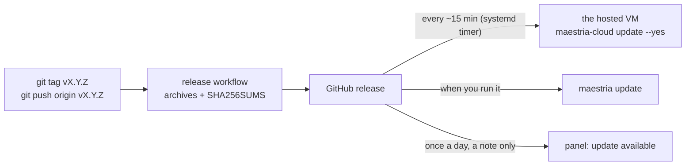

# Releasing

Shipping a version is pushing a tag. GitHub builds the release; every `maestria` and `maestria-cloud` that checks for updates picks it up. GitHub never holds credentials to any server: machines pull, nothing pushes.

## How updates reach people



- **Hosted VM:** a systemd timer runs `maestria-cloud update --yes` about every 15 minutes (installed by `packaging/linux/setup-cloud.sh`, opt out with `--no-auto-update`). A new tag reaches the VM within roughly 15 to 20 minutes.
- **Everyone else:** `maestria update` installs the latest release. The panel only *tells* people one exists (a line at startup and a dismissible note on the Security page, at most one request to GitHub a day); it never installs by itself. `"updates": {"check": false}` in `config.json` turns the check off.

What an update does, in order: finds the newest release (GitHub's public API, no token), downloads the archive for this OS and CPU, **checks the signature on `SHA256SUMS` when cosign is installed** (a missing or failing signature stops everything; without cosign it logs a warning), **checks the archive's SHA-256 against `SHA256SUMS`** (a mismatch or a missing entry stops everything), unpacks only the expected binary, runs it with `version`, replaces the old binary atomically, keeps the old one as `<name>.previous`, restarts the service if one runs, and waits up to 30 seconds for it to be healthy. If it is not, the previous binary is put back and the service restarted again. Development builds (`2.0.0-dev+abc1234`, or built without a version) never update by themselves, and nothing downgrades without `--force`.

The checksum file comes from the same GitHub release as the archive, so on its own it protects against a damaged download, not against someone who can publish to the repository. That is why the workflow also signs it, and why updates check the signature when cosign is installed (below, and [Verify a download](security.md#verify-a-download)). Protect the repository too: branch protection, two-factor sign-in, and a tag ruleset so only maintainers can create `v*` tags.

## What gets signed

The release workflow does three things after building, all keyless (GitHub's OIDC identity, nothing to store or rotate):

1. **Provenance** (`actions/attest-build-provenance`) for every archive, `SHA256SUMS` and `maestria.rb`: a signed statement of which workflow built the file from which commit. Check one with `gh attestation verify <file> -R paulo-lucas/maestria --signer-workflow paulo-lucas/maestria/.github/workflows/release.yml`.
2. **A cosign signature on `SHA256SUMS`**, published as `SHA256SUMS.sigstore.json`. The workflow then verifies it with the exact check the installers use, so a release whose signature the installers would reject fails here, before it is published.
3. **The Homebrew formula**, after the release exists (see below).

Rules that keep this meaningful:

- `release.yml` runs only on a `v*` tag push. Never add `workflow_call`, `workflow_dispatch` or a pull request trigger to it: installers trust the certificate because only this file, in this repository, on a tag push, can produce it.
- Every action is pinned by full commit SHA, and the cosign version is pinned too. To bump one, take the SHA from the real tag (`git ls-remote https://github.com/<owner>/<action>.git 'refs/tags/<tag>*'`, using the `^{}` line when the tag is annotated), never from memory.
- Top-level permissions are none; the release job gets `contents: write`, `id-token: write` and `attestations: write`, nothing else. It does not use the Go cache.
- **Never rename the repository or its owner** without updating every installer one-liner and the identity in the installers and the updater first.

## Cut a release

1. On `main`, with CI green, move the entries of **Unreleased** in [`CHANGELOG.md`](../CHANGELOG.md) under a new heading, `## [X.Y.Z] - YYYY-MM-DD`, and leave an empty **Unreleased** above it.
2. Commit it (`chore: release vX.Y.Z`).
3. Tag and push the tag:

   ```sh
   git tag vX.Y.Z
   git push origin main vX.Y.Z
   ```

   Versions are [semver](https://semver.org): `vMAJOR.MINOR.PATCH`. The tag must start with `v`.
4. Watch the **Release** workflow (`.github/workflows/release.yml`). It builds `maestria` and `maestria-cloud` for macOS (arm64, amd64), Linux (amd64, arm64) and Windows (amd64), writes `SHA256SUMS` and the Homebrew formula, and attaches them to a GitHub release.
5. Check the release page: for every binary and target there is one archive named `<binary>_<version>_<os>_<arch>.tar.gz` (`.zip` on Windows), plus `SHA256SUMS`, `SHA256SUMS.sigstore.json` and `maestria.rb`. Spot-check one with `gh attestation verify` (see above). For a stable release, the **Publish Homebrew formula** job then updates the tap.
6. Check that it arrived, from any machine that has the previous version:

   ```sh
   maestria update --check
   ```

   On the VM, the timer does the rest. To see it happen: `journalctl -u maestria-cloud-update -n 30`, and `maestria-cloud version`.

The asset names are produced by one function in `internal/update` (`ArchiveName`) that both `tools/release` and the updater use, and a test builds a real release and installs it through the updater, so the two cannot drift apart.

## Publishing the Homebrew formula

People install with `brew install paulo-lucas/tap/maestria`. The tap is the public repository `paulo-lucas/homebrew-tap`, and after every **stable** release (a tag without a hyphen) the workflow's **Publish Homebrew formula** job writes the release's `maestria.rb` to `Formula/maestria.rb` there. It runs in its own job, so the key it uses never shares a runner with the build, the signing step or the OIDC token.

Before it pushes anything, the job downloads the published `maestria.rb` and `SHA256SUMS`, runs `gh attestation verify` on the formula (this repository, `release.yml`, this tag), and checks that the formula's `REPO` is this repository, that all four `url` lines are this repository's release downloads, and that all four checksums appear in `SHA256SUMS`. If any check fails the job fails and nothing is pushed. Prereleases never reach the tap.

**One-time setup**

1. Make a key used for nothing else:

   ```sh
   ssh-keygen -t ed25519 -N "" -C "maestria release workflow" -f tap_deploy_key
   ```

2. In `paulo-lucas/homebrew-tap`: **Settings, Deploy keys, Add deploy key**. Paste `tap_deploy_key.pub` and tick **Allow write access**. A deploy key works for that one repository only, so a leak cannot touch anything else.
3. In `paulo-lucas/maestria`: **Settings, Environments, New environment** named `homebrew`. Restrict **Deployment branches and tags** to the tag pattern `v*`, and add the contents of `tap_deploy_key` as the environment secret `HOMEBREW_TAP_DEPLOY_KEY`.
4. Delete both key files from your machine.

If the secret is not set, the job prints a warning and finishes green: the release is never failed over the tap. Rotating the key is steps 1 to 4 again, then remove the old deploy key.

github.com's SSH host key is pinned in the workflow, not fetched while it runs. If GitHub ever rotates it, update the line from <https://api.github.com/meta> (`ssh_keys`), and compare its fingerprint with the one [GitHub publishes](https://docs.github.com/en/authentication/keeping-your-account-and-data-secure/githubs-ssh-key-fingerprints).

## Cut a prerelease

Use a semver prerelease tag, for example `v1.3.0-rc.1`, and push it as above. The workflow publishes any tag with a hyphen as a GitHub **pre-release** on its own. GitHub's "latest release" ignores prereleases, so the VM timer and a plain `maestria update` do not see it.

To try it on a machine you control:

```sh
maestria update --channel prerelease
```

The prerelease channel picks the highest version among all published releases, so once `v1.3.0` ships, that channel follows it.

## Roll back

A bad release should not stay the newest one. In order of speed:

1. **A machine that just updated and failed its health check** already rolled itself back. Nothing to do.
2. **Stop the spread:** on the release page, mark the bad release as a **pre-release** or **delete** it (keep the tag if you want to look at it). GitHub's "latest" then points to the previous release, and machines that have not updated yet stay where they are. If you delete the release but its tag still exists, delete the tag too (`git push origin :refs/tags/vX.Y.Z`) so it cannot be re-published by accident.
3. **Move machines that already updated back.** Updates never go backwards by themselves, so say so:

   ```sh
   sudo maestria-cloud update --yes --force --version vX.Y.Z    # on the VM
   maestria update --yes --force --version vX.Y.Z               # on a computer
   ```

   `--version` names the tag to install (an older one is fine with `--force`). Without `--version`, `--force` reinstalls the latest release.
4. **Right after an update**, the old binary is still next to the new one: `<name>.previous` (for example `/usr/local/bin/maestria-cloud.previous`). Copy it back over the binary and restart the service if you cannot reach GitHub.
5. Ship a fixed `vX.Y.(Z+1)`. Its tag is newer, so every machine moves forward to it.

Mind the database on the hosted server: a new version may change the schema. Before replacing the binary, `maestria-cloud update` runs the daily backup script (`/usr/local/sbin/maestria-cloud-backup`), so there is a copy from just before the update in `/var/backups/maestria-cloud`. Restoring is covered in [Run your own hosted server](deploy-cloud.md#10-back-up).

## Turn updates off

| Where | How |
| --- | --- |
| Hosted VM | Re-run `setup-cloud.sh` with `--no-auto-update`, or `sudo systemctl disable --now maestria-cloud-update.timer`. |
| The panel's notice | `"updates": {"check": false}` in `config.json`. |
