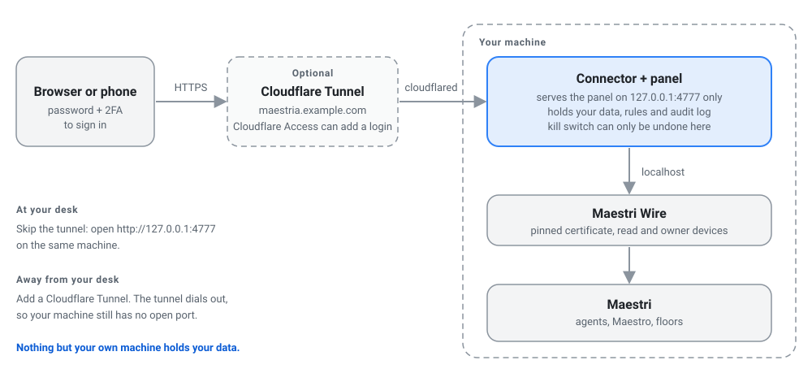

# Self-host Maestria

Self-hosting means the panel runs **on your own machine**, next to Maestri, and nobody else holds your data. This guide covers everything after [Getting started](getting-started.md):

1. [Running it as a service](#1-run-it-as-a-service)
2. [Reaching it from your phone, safely](#2-reach-it-from-your-phone-with-a-cloudflare-tunnel)
3. [Adding Cloudflare Access (optional)](#3-add-cloudflare-access-optional)
4. [The kill switch](#4-the-kill-switch)
5. [Updating](#5-update)
6. [Backups](#6-back-up)
7. [Uninstalling](#7-uninstall)



The panel listens on `127.0.0.1:4777` and **nowhere else**. That is fixed on purpose. To reach it from outside, you put a tunnel in front. The internet never connects to your machine.

## 1. Run it as a service

A **service** is a program your computer starts for you when you log in and keeps running. If you did not choose it in `maestria init`, do it now:

```sh
maestria service install
maestria service start
```

Then check:

```sh
maestria service status
maestria status
```

**What you should see:** `maestria status` ends with `Server:    running (http://127.0.0.1:4777)`.

| Command | What it does |
| --- | --- |
| `maestria service install [--mode serve\|connect\|both]` | Register the service. Default mode is `serve`. |
| `maestria service start` / `stop` / `restart` | Control it. |
| `maestria service status` | Is it installed and running? |
| `maestria service logs [-n 100]` | Show the last lines of the log. `--path` prints the log folder. |
| `maestria service uninstall` | Remove it. |

It uses **launchd** on macOS, **`systemd --user`** on Linux and **Task Scheduler** on Windows. You do not need administrator rights. Logs live in `logs/` inside your config directory.

Modes: `serve` is the local panel. `connect` is only the [hosted](hosted.md) connection. `both` runs the panel and the hosted connection in one process.

> **Only one at a time.** Only one `maestria serve` or `maestria connect` may run per config directory. A second one refuses with `another Maestria process is already running on this config directory`. Stop the first one (`maestria service stop`) or use the service only.

## 2. Reach it from your phone with a Cloudflare Tunnel

A **Cloudflare Tunnel** is a small program (`cloudflared`) that runs on your machine and makes an **outgoing** connection to Cloudflare. Cloudflare then gives you a normal `https://` address that leads back to your panel. Your machine opens no port and your router needs no change.

It is free. You need:

- A free [Cloudflare](https://dash.cloudflare.com/sign-up) account.
- A **domain name** that you added to Cloudflare. Any cheap domain works. Below we use `example.com` and the address `maestria.example.com`. **Use your own.**

### Step 1. Install `cloudflared`

| System | Command |
| --- | --- |
| macOS | `brew install cloudflared` |
| Windows | `winget install --id Cloudflare.cloudflared` |
| Linux | See [Cloudflare's install page](https://developers.cloudflare.com/cloudflare-one/connections/connect-networks/downloads/) for your distribution. |

Check it:

```sh
cloudflared --version
```

### Step 2. Sign in

```sh
cloudflared tunnel login
```

A browser opens. Pick your domain and authorize. **What you should see:** "You have successfully logged in", and a certificate saved in `~/.cloudflared/`.

### Step 3. Create the tunnel

```sh
cloudflared tunnel create maestria
```

**What you should see:** a **tunnel ID** (a long code like `6ff42ae2-…`) and the path of a credentials file, `~/.cloudflared/<ID>.json`. Write the ID down.

### Step 4. Choose the address

```sh
cloudflared tunnel route dns maestria maestria.example.com
```

This makes `maestria.example.com` lead to your tunnel.

### Step 5. Say where the panel is

Create the file `~/.cloudflared/config.yml` (on Windows: `%USERPROFILE%\.cloudflared\config.yml`). Replace the two placeholders:

```yaml
tunnel: <TUNNEL-ID>
credentials-file: /Users/you/.cloudflared/<TUNNEL-ID>.json

ingress:
  - hostname: maestria.example.com
    service: http://127.0.0.1:4777
  - service: http_status:404
```

The last line means: anything else gets a 404.

### Step 6. Tell Maestria about the address

This step is the one people forget. Maestria refuses requests for names it does not know, to stop a trick called DNS rebinding. Add your name:

```sh
maestria config allow-host maestria.example.com
maestria service restart
```

**What you should see:** `The panel now answers to maestria.example.com. Restart it to apply …`

Without this, the browser shows `Misdirected request: this Maestria panel does not answer to …`. See [Troubleshooting](troubleshooting.md).

Other commands: `maestria config hosts` lists the names. `maestria config disallow-host <host>` removes one.

### Step 7. Start the tunnel

Try it first in the foreground:

```sh
cloudflared tunnel run maestria
```

Open `https://maestria.example.com` on your phone. **What you should see:** the Maestria sign-in page. Sign in with your password and your authenticator code.

Press `Ctrl+C` to stop it. To keep it running all the time, install it as a service:

```sh
cloudflared service install
```

(On Linux and Windows this may need an administrator terminal. See Cloudflare's [run as a service](https://developers.cloudflare.com/cloudflare-one/connections/connect-networks/configure-tunnels/local-management/as-a-service/) page.)

### Step 8. Count real visitor addresses

Behind Cloudflare, every request seems to come from your own machine, so the sign-in limits could not tell visitors apart: one stranger's failed attempts would lock everyone out. Since you allowed a public host name (`maestria config allow-host`), Maestria now **reads the visitor's address from Cloudflare's `CF-Connecting-IP` header automatically**. You do not need to do anything. Opening the panel directly on the machine (`http://127.0.0.1:...` or `http://localhost:...`, with no proxy in between) is not locked out by strangers' failed attempts. With a tunnel that does not report visitor addresses (ngrok, Tailscale Funnel, `ssh -R`, a plain reverse proxy), all of its visitors share one limit, so a stranger can lock the sign-in *for the tunnel*; you at the machine are unaffected. Make sure such a proxy adds an `X-Forwarded-For` header (most do), otherwise its visitors cannot be told apart from you at the machine.

If your tunnel is **not** Cloudflare's and lets a visitor send that header themselves, turn this off so a stranger cannot pick the address the limits see. Open `config.json` in your config directory (`~/.config/maestria/config.json`) and add:

```json
{
  "trustCfConnectingIp": false
}
```

Then `maestria service restart`. (Setting it to `true` also works, to force it on without a public host name.)

### Is it secure enough?

Yes, on its own: you sign in with a long password **and** a 6-digit code, with limits on failed attempts. Everything travels over `https`. For a second lock, add Cloudflare Access.

## 3. Add Cloudflare Access (optional)

**Cloudflare Access** puts a login page from Cloudflare in front of your address. Only people you list can even reach Maestria's sign-in page. Maestria then also checks Cloudflare's signed proof on every request.

1. In the Cloudflare dashboard open **Zero Trust**. (The free plan is enough. It asks you to pick a team name once.)
2. Go to **Access → Applications → Add an application → Self-hosted**.
3. Set the **domain** to `maestria.example.com`.
4. Add a **policy** that allows only your own email address.
5. Save, then open the application and copy its **Application Audience (AUD) tag** (a long hex code).
6. Note your **team domain**. It looks like `yourteam.cloudflareaccess.com`.

Now tell Maestria. In `config.json` add:

```json
{
  "cloudflareAccess": {
    "teamDomain": "yourteam.cloudflareaccess.com",
    "audience": "<AUD-TAG>"
  }
}
```

Then `maestria service restart`.

From now on, a request without a valid Cloudflare Access token is refused, even if someone finds your tunnel address.

## 4. The kill switch

The **kill switch** is the emergency stop for remote access. Use it if you lose your phone, or if something looks wrong.

Turn it **on** from either place:

- **In the panel:** the power button in the top bar, or **Security → Kill switch**.
- **In a terminal:**

```sh
maestria tunnel off
```

**What you should see:** `Kill switch activated. Invalidated N session(s).`

When it is on:

- Every browser is signed out.
- Nobody can sign in, including you, until it is turned off.
- If you set a stop command (below), your tunnel is stopped too.

Turn it **off** only from the machine itself, in a terminal:

```sh
maestria tunnel on
```

**What you should see:** `Tunnel access re-enabled locally (kill switch cleared).`

This asymmetry is deliberate. Anyone who got into your panel can turn the switch on, but nobody can turn it off remotely, because **no web page or API exists for that**.

Check the state any time:

```sh
maestria tunnel status
```

### Let it stop your tunnel too

You can tell Maestria which commands stop and start your tunnel. Add to `config.json` (each is a list: the program, then its arguments). This example is for a Linux `systemd --user` service:

```json
{
  "tunnel": {
    "stopCommand": ["systemctl", "--user", "stop", "cloudflared"],
    "startCommand": ["systemctl", "--user", "start", "cloudflared"],
    "statusCommand": ["systemctl", "--user", "is-active", "cloudflared"]
  }
}
```

These commands run **without a shell**, so nothing in them is interpreted.

## 5. Update

Run the same install command you used first. It replaces the program and checks the checksum.

| How you installed | Update with |
| --- | --- |
| install script | `curl -fsSL https://raw.githubusercontent.com/paulo-lucas/maestria/main/install.sh \| sh` |
| Homebrew | `brew upgrade maestria` |
| Windows | `irm https://raw.githubusercontent.com/paulo-lucas/maestria/main/install.ps1 \| iex` |

Then **restart the service** so the running panel picks up the new version:

```sh
maestria service restart
maestria version
```

Your settings and data are kept. To install a specific version with the script, set `MAESTRIA_VERSION` (for example `MAESTRIA_VERSION=v0.2.0`).

## 6. Back up

Everything Maestria keeps is in **one folder**, your config directory:

- macOS and Linux: `~/.config/maestria` (or `$MAESTRIA_CONFIG_DIR`)
- Windows: `%AppData%\maestria`

| File | What it holds |
| --- | --- |
| `config.json` | Your settings |
| `auth-v2.json` | Your password hash and authenticator secret |
| `maestria-v2.db` | Tasks, chat, floors, history and the audit log |
| `workspaces.json` | The workspaces you registered |
| `wire.json` | The Wire keys (only if paired) |
| `cloud.json` | The hosted link (only if linked) |

To back up safely:

```sh
maestria service stop
cp -R ~/.config/maestria ~/maestria-backup
maestria service start
```

Stopping first makes sure the database is not being written while you copy it. **Keep the backup private.** It contains secrets (the files are `0600`, readable only by you).

To restore, stop the service, put the folder back, and start it again. Your Maestri data folder is **not** part of this: Maestria never changes it.

## 7. Uninstall

1. Stop and remove the service:

   ```sh
   maestria service uninstall
   ```

2. If you linked a hosted server, unlink first so it forgets this machine: `maestria connect unlink`.
3. If you paired Wire, revoke it in Maestri: `maestria wire unpair`.
4. Delete the program:
   - install script: remove `~/.local/bin/maestria`
   - Homebrew: `brew uninstall maestria`
   - Windows: delete `%LOCALAPPDATA%\Programs\Maestria` and remove it from your `Path`
5. Delete your data (this **cannot be undone**): the config directory (`~/.config/maestria` or `%AppData%\maestria`).
6. Delete the skill if you installed it: `~/.claude/skills/maestria` and/or the matching folder under `~/.gemini/`.
7. Remove the tunnel if you made one: `cloudflared tunnel delete maestria`, and delete the DNS record in Cloudflare.

## Next

- [Security](security.md): what the protections are.
- [Troubleshooting](troubleshooting.md): when something does not work.
