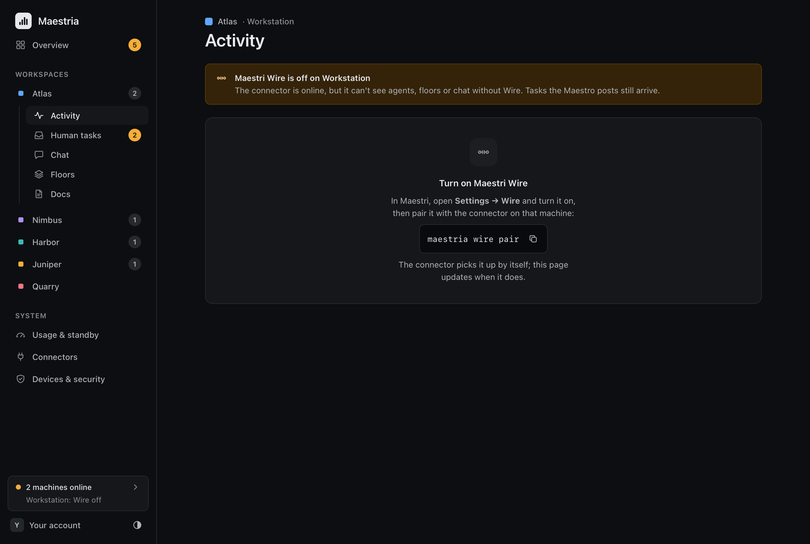

# Connect Maestria to Maestri Wire

**Maestri Wire** is a feature of Maestri that lets other programs read what is going on (agents, chat, floors) and, with your permission, act on it. Maestria uses it to give you:

- **Live agents** on the Activity page and the Overview.
- **Chat**: read your Maestro's chat and write to it.
- **Floors** that follow Maestri as they change.
- **Agent prompts**: when an agent waits for a yes/no, you can answer from the panel.

Without Wire, Maestria still works. You still get the human tasks your Maestro posts, usage and standby, and the Floors your Maestro plans. You just do not see live agents or chat. The panel tells you so, and shows the steps to fix it.

<p>
  
</p>

Wire is in beta in Maestri, and it runs on macOS and Windows.

## Pair in four steps

### 1. Turn Wire on in Maestri

In Maestri, open **Settings → Wire** and switch it on. Leave that window open: you need two things from it.

- The **Pairing** tab shows a **6-digit pairing code**. It lasts 5 minutes and works **once**.
- The **Manual** tab shows the **Security key**. It is a long string of pairs, like `3F:A2:09:…`.

### 2. Start pairing

In your terminal:

```sh
maestria wire pair
```

You will answer **three questions, in order**.

**What you should see first:**

```text
Pairing with Maestri Wire. First, in the Maestri app: Settings → Wire, turn Wire on.
You will answer three questions in order: where Wire runs, its security key, and a pairing code.
```

### 3. Answer the three questions

**Question 1 of 3: where does Maestri run?**

```text
1/3 Where does Maestri run? Press Enter if it is this machine.
    Host [localhost:7434]:
```

If Maestri runs on this computer, **press Enter**. If it runs on another machine, type its address, like `192.168.1.20:7434`.

**Question 2 of 3: the security key**

This key proves that you are talking to your own Maestri and not to something pretending to be it.

*On the same machine*, Maestria reads the key by itself and shows it:

```text
2/3 Security key: it proves Maestria is talking to your Maestri.
    Wire on this machine presents this key:
      3F:A2:09:…
    It should match the "Security key" in Maestri's "Manual" tab. Press Enter to trust it.
    Security key [Enter = trust the key above]:
```

Compare the first characters with the **Manual** tab in Maestri. If they match, **press Enter**.

*On another machine*, Maestria cannot check for you, so you type it. Copy the **Security key** from the Manual tab and paste it.

**Question 3 of 3: the pairing code**

```text
3/3 Pairing code: in Maestri, open the "Pairing" tab and type the 6-digit code shown there.
    Pairing code or password:
```

Type the 6-digit code from the **Pairing** tab. Nothing appears as you type. That is normal.

If you set a Wire **password** in Maestri's Manual tab, you can type that instead.

### 4. Type the second code

With a pairing code, you are asked once more:

```text
First device paired. Maestria pairs a second device (one reads, one acts), and a code works once:
wait for the Pairing tab to show a NEW code and type it.
    New pairing code:
```

**Wait for Maestri to show a new code**, then type it. (Why two codes? See below.)

**What you should see:**

```text
Paired with localhost:7434.
  Reads:  a read-only (guest) device
  Writes: an owner device, used only for prompts, Y/n answers and interrupts
Saved to /Users/you/.config/maestria/wire.json (readable only by you). The panel picks it up by itself.
```

The panel picks it up within a few seconds. Check it:

```sh
maestria wire status
```

**What you should see:** `Link: connected`, `Reads: guest`, `Writes: owner`.

> `maestria init` offers to do all of this for you at the end of setup.

## Why two pairing codes?

Maestria pairs **two devices**, so it can keep powers apart:

| Device | Role in Maestri | Used for |
| --- | --- | --- |
| **Read-only device** | guest | Everything Maestria *reads*: agents, chat, floors. Can change nothing. |
| **Owner device** | owner | Only the few things you can *do*: send a message, answer a yes/no, interrupt an agent. |

A pairing code works only **once**, so each device needs its own. If you use a Wire password instead of a code, Maestria reuses it for both and asks nothing more.

Why bother? Reading is constant and safe. Acting is rare and powerful. The owner key is only taken out for the rare action.

## What Maestria can and cannot do through Wire

Every request goes through one fixed list. Anything not on the list is refused before it leaves your computer.

**Can read** (read-only device):

- The list of workspaces, agents, floors and their status.
- The live feed of agent status and terminal previews.
- The chat.

**Can do** (owner device, and only these three things):

- Send a message to a workspace's Maestro terminal.
- Answer a yes/no prompt (approve or reject).
- Send **Esc** to an agent, to interrupt it (this is how the standby guard interrupts agents).

**Cannot do, ever:** create, delete, land or kill anything. Run git commands. Change settings. Read notes or files. Reach any other route Wire offers.

Two more safeguards:

- Both keys are stored in `wire.json` in your config directory, readable only by you. They are **never shown to, or sent to, a browser**.
- Every change you make from the panel is recorded in the audit log (**Security** page).

## Unpair

```sh
maestria wire unpair
```

**What you should see:**

```text
Revoked the read-only device in Maestri.
Revoked the owner device in Maestri.
Deleted wire.json.
```

This removes both devices in Maestri and deletes the stored keys. If Maestri cannot be reached, Maestria says so and tells you to remove the devices in **Settings → Wire**. Access also ends by itself after 30 idle days.

## Troubleshooting

`maestria wire status` shows the current state and the last error. The states are:

| `Link` | What it means | What to do |
| --- | --- | --- |
| `connected` | All good. | Nothing. |
| `disabled` | Not paired. | `maestria wire pair`. |
| `connecting` | Paired, waiting for Maestri to answer. | Wait a few seconds. |
| `unreachable` | Wire is off, or Maestri is not running. | In Maestri, open **Settings → Wire** and turn it on. Maestria keeps trying. |
| `pin_mismatch` | The security key changed. Maestria refuses to talk. | Only if *you* reset Wire: `maestria wire unpair`, then `maestria wire pair`. If you did not, something else is answering where Maestri should be. |
| `revoked` | Maestri no longer accepts this connector, or it expired after 30 idle days. | Get a new code, then `maestria wire pair`. |
| `incompatible` | Maestri speaks a Wire version Maestria does not know. | Update Maestria. |
| `role` | The read-only device has more rights than expected. | `maestria wire unpair`, then `maestria wire pair`. |

Messages you may see while pairing:

| Message | Fix |
| --- | --- |
| `Wrong pairing code or password.` | Type the code again. Codes last 5 minutes and work once. |
| `Too many attempts. Wait … and try again.` | Wait as long as it says. |
| `The security key does not match the host's certificate.` | Copy the key again from **Settings → Wire → Manual → Security key**. |
| `Could not reach Maestri Wire. Check that it is on in Settings → Wire, and the host and port.` | Turn Wire on in Maestri. Check the host and port. |
| `Password pairing is not enabled on this host.` | Use a pairing code from **Settings → Wire → Pairing**. |
| `That looks like the 6-digit pairing code: it comes in the next step.` | At the security key question, paste the *long* key, not the code. |

More: [Troubleshooting](troubleshooting.md).

## Good to know

- Pairing is local. Maestria connects to Wire from your machine, even in hosted mode. The hosted server never sees the Wire keys.
- Wire is only reachable by address, `localhost`, a `.local` name or a Tailscale name (`.ts.net`). That is Maestri's rule.
- Wire is a beta feature and may change. Maestria checks the version, and says so in the panel if it does not understand.
